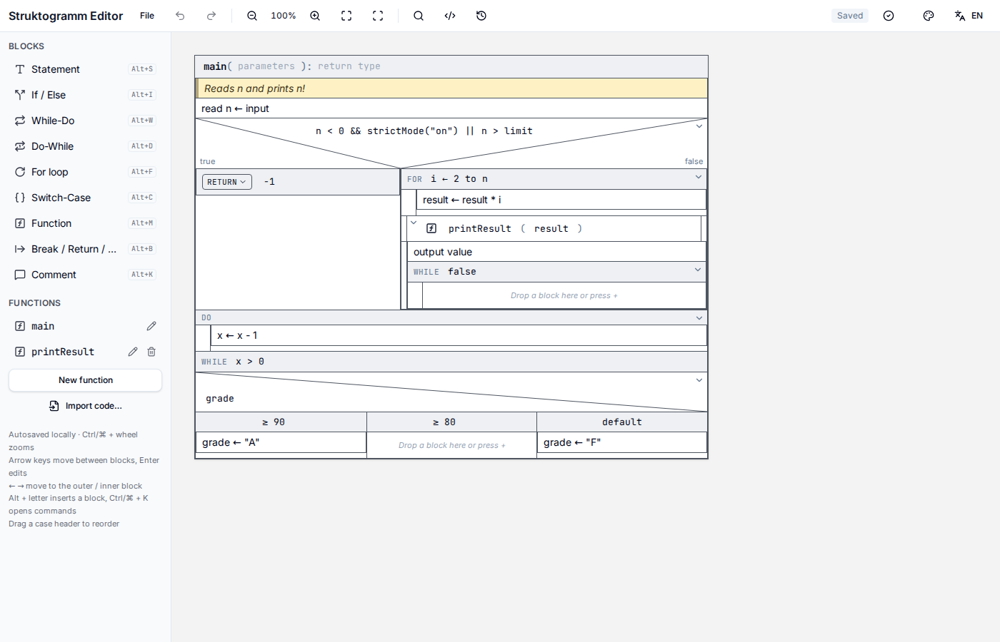

# Struktogrammer

A desktop editor for **Nassi–Shneiderman diagrams** (Struktogramme). It runs fully offline and is built with [Tauri 2](https://tauri.app), React and TypeScript.



## Download

Ready-made installers are on the [Releases page](https://github.com/copedd4/Struktogrammar/releases/latest). You don't need Node.js or Rust to use them.

| Platform | File to download                                 |
| -------- | ------------------------------------------------ |
| Windows  | `Struktogrammer_x.y.z_x64-setup.exe` (or `.msi`) |
| macOS    | `Struktogrammer_x.y.z_universal.dmg`             |
| Linux    | `.AppImage`, `.deb` or `.rpm`                    |

The builds are not code-signed, so your system will warn you on first launch:

- **Windows:** SmartScreen shows "Windows protected your PC". Click **More info → Run anyway**.
- **macOS:** right-click the app and choose **Open**, or remove the quarantine flag: `xattr -dr com.apple.quarantine Struktogrammer.app`.

To build it yourself instead, read on.

## Features

- **All structogram blocks**: statement, if/else, while, do-while, for, switch-case, function call, break/return/continue and comment.
- **Functions as their own diagrams**, with parameters and a return type. A call can be opened in a window or expanded inline.
- **Editing**: drag and drop, insert buttons between blocks, undo/redo with a history list, search, validation, and a command palette.
- **Copy and paste through the system clipboard**, also between documents. Blocks carry the functions they call.
- **Export** to vector SVG, PNG or multi-page PDF, either the current diagram or the full call tree.
- **Code** generation to C, Java, JavaScript and Python, and import of existing code into blocks.
- **Five themes** and an English/German interface.
- **Files** are saved as `.stkg` projects (JSON). The editor also autosaves locally.

## Prerequisites

You need **Node.js**, **Rust** and your operating system's **Tauri dependencies**.

| Tool    | Version          | Install                                  |
| ------- | ---------------- | ---------------------------------------- |
| Node.js | 20.19+ or 22.12+ | <https://nodejs.org> (npm comes with it) |
| Rust    | stable, 1.77.2+  | <https://rustup.rs>                      |

### Windows

1. Install [Microsoft C++ Build Tools](https://visualstudio.microsoft.com/visual-cpp-build-tools/) and choose the **"Desktop development with C++"** workload.
2. WebView2 is already part of Windows 10 (1803+) and Windows 11. On older systems, install the [WebView2 Runtime](https://developer.microsoft.com/microsoft-edge/webview2/).
3. Install Rust with `rustup` and use the MSVC toolchain (the default): `rustup default stable-msvc`.

### macOS

```sh
xcode-select --install
```

### Linux

Debian / Ubuntu:

```sh
sudo apt update
sudo apt install libwebkit2gtk-4.1-dev build-essential curl wget file \
  libxdo-dev libssl-dev libayatana-appindicator3-dev librsvg2-dev
```

For Fedora, Arch, openSUSE and others, see the [Tauri prerequisites](https://v2.tauri.app/start/prerequisites/#linux).

## Getting started

```sh
git clone https://github.com/copedd4/Struktogrammar.git
cd Struktogrammar
npm ci
npm run tauri:dev
```

`npm ci` installs the exact dependency versions from `package-lock.json`. Use `npm install` only when you want to add or update packages.

`npm run tauri:dev` starts the frontend dev server on port 1420 and opens the app window. Changes to the frontend reload instantly; changes in `src-tauri/` rebuild the Rust part. The first run compiles all Rust dependencies, which takes a few minutes.

## Building the app

```sh
npm run tauri:build
```

The installers end up in `src-tauri/target/release/bundle/`:

| Platform | Output                                             |
| -------- | -------------------------------------------------- |
| Windows  | `msi/*.msi` and `nsis/*-setup.exe`                 |
| macOS    | `macos/Struktogrammer.app` and `dmg/*.dmg`         |
| Linux    | `deb/*.deb`, `rpm/*.rpm` and `appimage/*.AppImage` |

To build only one format, pass it through after `--`, for example only the Windows `.exe` installer:

```sh
npm run tauri:build -- --bundles nsis
```

### Installer or portable `.exe`?

On Windows the build produces two kinds of executable:

- `src-tauri/target/release/bundle/nsis/Struktogrammer_x.y.z_x64-setup.exe` is an **installer**. It adds the app to the Start menu and can be uninstalled normally.
- `src-tauri/target/release/struktogrammer.exe` is the **app itself**. You can copy this single file anywhere (for example a USB stick or a PC without install rights) and run it directly. It still needs the WebView2 runtime, which Windows 10/11 already has.

Each platform has to be built on that platform: Windows installers on Windows, macOS apps on a Mac. The release workflow below takes care of this for you.

Unsigned builds trigger a warning on first launch; see [Download](#download) for how to get past it.

### Publishing a release

[`.github/workflows/release.yml`](.github/workflows/release.yml) builds the installers for Windows, macOS and Linux on GitHub's servers and attaches them to a **draft** release.

1. Bump the version in `package.json`, `src-tauri/tauri.conf.json` and `src-tauri/Cargo.toml`.
2. Commit, then tag and push:

   ```sh
   git tag v0.1.0
   git push origin v0.1.0
   ```

   You can also start it by hand under **Actions → Release → Run workflow**.

3. When the workflow finishes, open **Releases**, check the draft and click **Publish release**.

## Scripts

| Command                   | What it does                                                                                                  |
| ------------------------- | ------------------------------------------------------------------------------------------------------------- |
| `npm run tauri:dev`       | Run the desktop app in development mode                                                                       |
| `npm run tauri:build`     | Build the release app and installers                                                                          |
| `npm run tauri -- <args>` | Any other [Tauri CLI](https://v2.tauri.app/reference/cli/) command, e.g. `npm run tauri -- icon app-icon.png` |
| `npm run build`           | Type-check and build only the frontend into `dist/`                                                           |
| `npm run lint`            | ESLint and Prettier checks                                                                                    |
| `npm run format`          | Format all files with Prettier                                                                                |

## Keyboard shortcuts

`Ctrl` is `⌘` on macOS.

| Keys                                                        | Action                                                                               |
| ----------------------------------------------------------- | ------------------------------------------------------------------------------------ |
| `Alt` + `S` / `I` / `W` / `D` / `F` / `C` / `M` / `B` / `K` | Insert statement / if / while / do-while / for / switch / function / break / comment |
| `Enter`                                                     | Edit the selected block                                                              |
| `↑` `↓`                                                     | Previous / next block                                                                |
| `←` `→`                                                     | Enclosing / first nested block                                                       |
| `Ctrl` + `C` / `X` / `V`                                    | Copy / cut / paste blocks                                                            |
| `Ctrl` + `D`                                                | Duplicate                                                                            |
| `Delete`                                                    | Delete the selected block                                                            |
| `Ctrl` + `Z` / `Ctrl` + `Y`                                 | Undo / redo                                                                          |
| `Ctrl` + `S` (`+ Shift`)                                    | Save (save as)                                                                       |
| `Ctrl` + `O`                                                | Open                                                                                 |
| `Ctrl` + `K`                                                | Command palette                                                                      |
| `Ctrl` + mouse wheel                                        | Zoom                                                                                 |

## Project structure

```
src/
  main.tsx                  app entry
  components/strukto/       editor UI (canvas, blocks, dialogs, palette)
  components/ui/            shared UI components (shadcn/ui, Radix)
  lib/strukto/
    types.ts, model.ts      document model and tree helpers
    store.tsx, ops.ts       state, undo/redo and editing operations
    schema.ts, fileio.ts    .stkg validation, open/save, recent files
    render.ts, exporting.ts SVG/PNG/PDF export
    geometry.ts             layout of the if/switch diagonals
    codegen.ts, codeimport.ts  code generation and import
    i18n.tsx, themes.ts     translations and themes
src-tauri/                  Rust shell: window, config, icons, capabilities
index.html, vite.config.ts  frontend build
```

## The `.stkg` file format

A project is a JSON document:

```json
{
  "version": 1,
  "format": "stkg",
  "name": "Factorial",
  "mainId": "a1b2c3",
  "functions": {
    "a1b2c3": {
      "id": "a1b2c3",
      "name": "main",
      "body": [{ "kind": "statement", "id": "x1", "text": "read n" }]
    }
  }
}
```

Block kinds are `statement`, `comment`, `if` (`cond`, `then`, `else`), `while` / `dowhile` / `for` (`cond`, `body`), `switch` (`expr`, `cases`, `defaultCase`), `call` (`funcId`, optional `args`) and `terminator` (`variant`: `break` | `return` | `continue`, `text`). Files are validated when opened. A file written by a newer version of the app is rejected with a message.

## Troubleshooting

- **`Port 1420 is already in use`**: another dev server is still running. Stop it, or change the port in both `vite.config.ts` and `src-tauri/tauri.conf.json` (`build.devUrl`).
- **Linux: `webkit2gtk-4.1` / `gdk-3.0` not found**: install the Linux packages listed above.
- **Windows: `link.exe` not found**: the C++ Build Tools are missing, or Rust uses the GNU toolchain. Run `rustup default stable-msvc`.
- **Windows: "Windows protected your PC"**: the `.exe` is not code-signed. Click **More info → Run anyway**.
- **Portable `.exe` shows a blank window or won't start**: the WebView2 runtime is missing. Install it from [Microsoft](https://developer.microsoft.com/microsoft-edge/webview2/).
